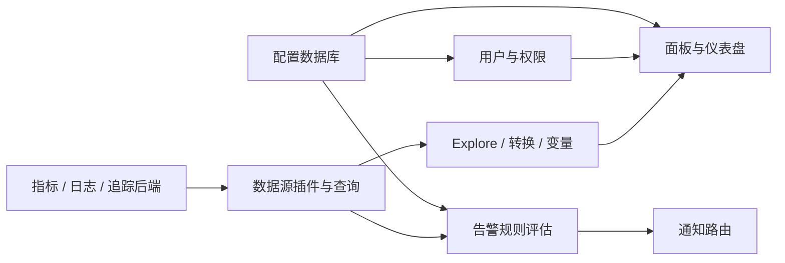

# Grafana OSS · Recipkg

**把分散的指标、日志与追踪放进可查询、可比较、可告警的工作台。**

[](https://github.com/grafana/grafana)
[](https://github.com/grafana/grafana/blob/752e3462ff71a43a5c1fb62d00a482fa2dc0ee6a/LICENSE)
[](https://github.com/recipkg/standard-library)

[标准库](https://github.com/recipkg/standard-library) · [重建配方](RECIPE.md) · [构建提示词](BUILD_PROMPT.md) · [验收计划](ACCEPTANCE.md) · [覆盖记录](COVERAGE.md) · [来源与许可](SOURCES.md)

## 数据如何经过 Grafana



Grafana 自己的配置数据库与被查询的数据后端是两套东西。图示依据官方 OSS 文档和固定源码服务入口整理，不是运行截图或重建验收结果。

## 固定目标

- 上游：[Grafana OSS v13.3.0](https://github.com/grafana/grafana/tree/752e3462ff71a43a5c1fb62d00a482fa2dc0ee6a)
- 固定提交：`752e3462ff71a43a5c1fb62d00a482fa2dc0ee6a`
- 根许可证：AGPL-3.0
- 2026-10-29 星数快照：77,583；不表示完整性或质量
- 标准库分类：监控与可观测性 / 仪表盘与告警

本仓库只保存 Markdown 重建配方，不包含 Grafana 源码、插件、仪表盘数据或数据库。当前状态为**提取中**；没有运行 Grafana、连接数据源或做浏览器验收。覆盖和缺口见 [COVERAGE.md](COVERAGE.md)。

## 依赖与版本边界

| 别名 | 用途 | 边界 |
| --- | --- | --- |
| `quality` | 权限、配置一致性、失败恢复和性能证据 | 不是运行时服务 |
| `design` | 仪表盘、Explore 与告警的界面方向 | 递归包含设计基础，不代表 UI 已验收 |

Grafana OSS 默认使用内嵌 SQLite 保存自身配置；PostgreSQL/MySQL 是可选配置后端。Prometheus、Loki 等则是被查询的数据源。Grafana Enterprise 和 Cloud 的商业功能不属于固定目标。

## 检查配方包

```sh
out_dir="$(mktemp -d)"
recipkg pack . -o "$out_dir/grafana-0.1.0.recipe.tar.gz"
recipkg check "$out_dir/grafana-0.1.0.recipe.tar.gz"
recipkg build "$out_dir/grafana-0.1.0.recipe.tar.gz" --lang zh-CN --output "$out_dir/build.md"
```

这些命令检查配方和递归依赖，不证明 Grafana OSS、任何数据源或插件已经重建。
